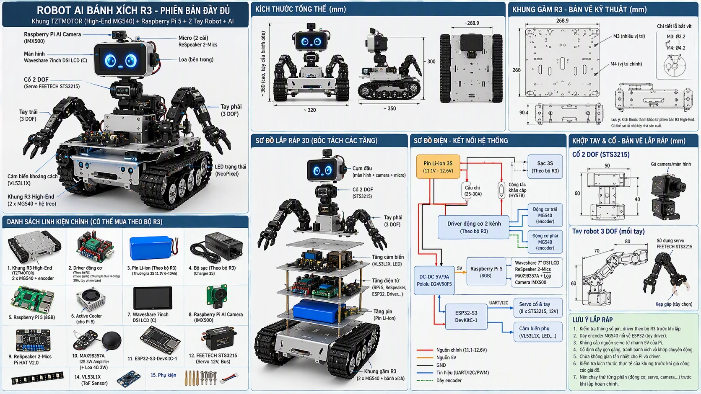

# ai-robot

> **Status:** early setup — project skeleton and documentation only; no code yet.

A mobile AI robot on a tracked chassis, with **two arms**, a **2-DOF neck** carrying a 7" display as an expressive face, voice interaction, and an AI camera.

- **Brain:** Raspberry Pi 5 (8 GB) — audio, vision, face, AI and networking (built-in Wi-Fi and Bluetooth LE).
- **Body:** ESP32-S3 — real-time control of servos, motors and encoders, sensors and LEDs.



*Concept v0 — a quick sketch (labels in Vietnamese); the arm design may still change.*

## Repository layout

```
ai-robot/
├── software/    Main application running on the Raspberry Pi 5
├── firmware/    Microcontroller modules (body-controller = ESP32-S3)
├── protocol/    Pi ⇄ module protocol — single source of truth for both sides
├── hardware/    Bill of materials, power tree, pin map, component notes, CAD
├── docs/        Vision, architecture, decision records (ADRs), dev log
├── tools/       Utility scripts
└── .claude/     Task checklists for AI assistants (see AGENTS.md)
```

Each folder is an independent component with its own README; see [Contributing](CONTRIBUTING.md#adding-or-removing-a-component) for how to add or remove one.

## Documentation

- [docs/](docs/README.md) — vision, architecture, decision records (ADRs), dev log
- [hardware/](hardware/README.md) — parts, power tree, pin map, open issues
- [CONTRIBUTING.md](CONTRIBUTING.md) — branches, commits, documentation, secrets, licensing

## Related repositories

| Repository | Role | Status |
|---|---|---|
| `ai-robot-server` | AI backend and device management | Not created yet |
| `ai-robot-app` | Mobile companion app | Not created yet |
| [Luni_Robot](https://github.com/trungnguyen278/Luni_Robot) | Previous generation (ESP32-S3 + ESP32-C5) | Superseded — see [docs/legacy.md](docs/legacy.md) |

## License

Released under the [MIT License](LICENSE).
