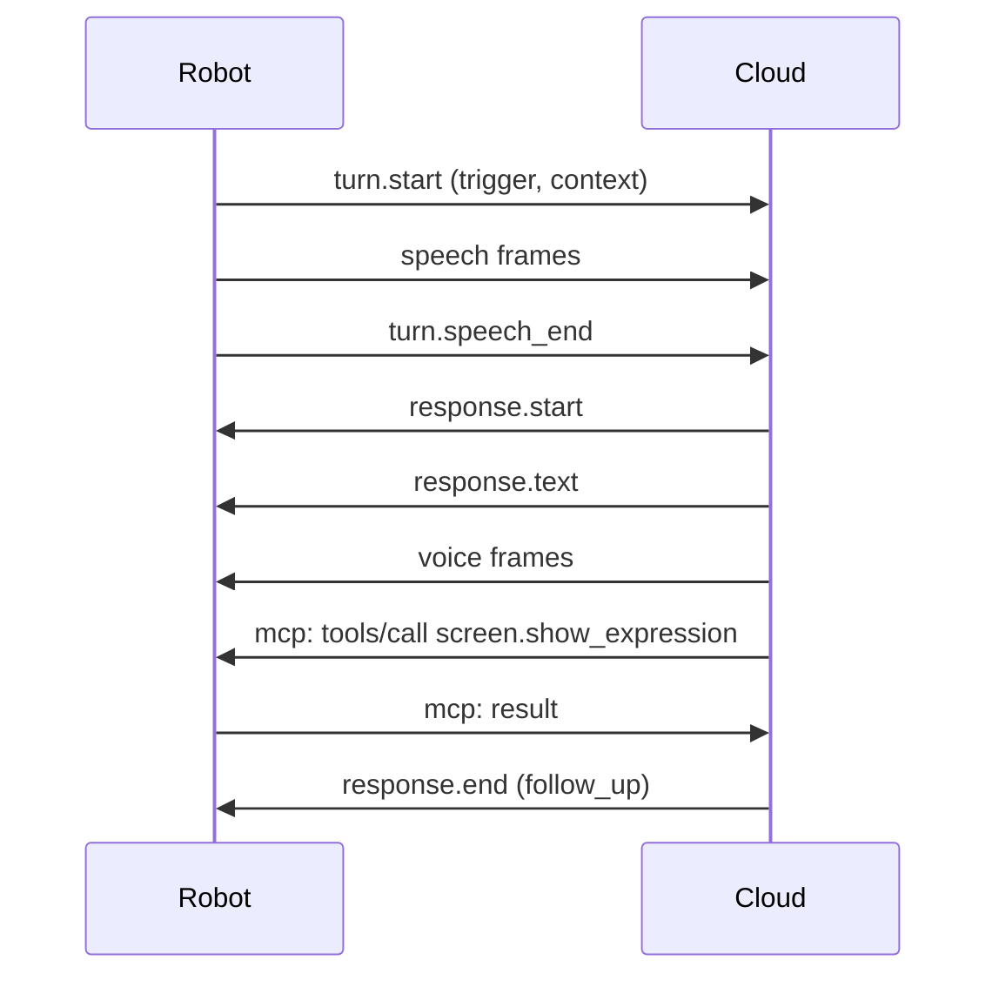

# Cloud link — robot ⇄ ai-robot-server

> **Being replaced:** [ADR-0009](../../docs/decisions/0009-cloud-link-webrtc.md) moves this link to WebRTC, through a LiveKit server. Version 2.0 replaces this version's connection, media offer and audio frames; the messages stay.

The link between the robot software and `ai-robot-server`:
- On the robot (`software/`), it is the `cloud` module and the `websocket` adapter of its `cloud` port.
- The server, built anew, does not exist yet.

The robot's core AI runs in the cloud. The robot captures, plays, shows and moves, and keeps everything safe. This link carries:
- speech both ways, and the context of each turn;
- events;
- the calls through which the cloud drives the robot.

Version **1.0**:
- It builds on [ADR-0007](../../docs/decisions/0007-cloud-link-transport.md) (one WebSocket over TLS) and [ADR-0008](../../docs/decisions/0008-cloud-link-messages.md) (typed JSON, MCP for capabilities, binary audio frames). Both ADRs are proposed.
- It meets the [requirements](requirements.md), whose identifiers (SES-2, NEG-3…) it cites.
- [`schema.json`](schema.json) defines every message, in JSON Schema 2020-12.
- [`examples/`](examples/) holds whole sessions. The robot's tests check them, and the robot's own messages, against the schema (`software/tests/test_cloud_protocol.py`, `test_web_cloud.py`).

> **Implemented by the robot so far:** the connection, the session, capabilities and events. Turns, responses and audio frames are specified below, but they wait for the voice pipeline (wake word, voice activity detection). Until then:
> - the robot offers no audio formats, so the cloud declines both streams;
> - it ignores turn and response messages.

## Connection

- **Address.** The robot opens one WebSocket to the server's address, taken from its configuration:
  - `wss://`: TLS, with the server's certificate checked against the system's trusted authorities;
  - `ws://`, only to the robot itself (`127.0.0.1`, `::1`, `localhost`), for development (SEC-1).
- **Credentials.** These are provisional, until decision 5 of the requirements:
  - The robot sends `Authorization: Bearer <token>` in the opening handshake. The token comes from the environment variable `AI_ROBOT_CLOUD_TOKEN`, never from a file in the repository.
  - The server refuses unknown credentials with HTTP 401, before the WebSocket opens.
- **One connection per robot.** When the same robot connects again, the server closes the older connection with code 4002.
- **Liveness.** A side that has received nothing for a while sends a WebSocket ping, and closes the connection if no pong follows (SES-3). On the robot, a while is `ping_after`, 10 s as shipped.
- **Reconnection.** After a loss, the robot waits before connecting again, a random time from 0 to `min(reconnect_max, reconnect_first × 2ⁿ)`, where n counts the failed attempts in a row: up to 1 s, then 2 s, and so on to 60 s as shipped. This is exponential backoff with full jitter (SES-4). A connection that reaches the `hello` exchange resets n.
- **Compression.** None per message: audio is already compressed, and control messages are small.
- **The robot's settings.** The robot's timings and rates in this section are settings, in `[ports.cloud.websocket]` of `software/config/base.toml`: what this document gives are the values as shipped. The sizes, the codes and the versions are the protocol's own, and do not change without a new version.
- **Sizes.** A text frame holds up to 1 MiB, a binary frame up to 64 KiB. A larger frame closes the connection with 1009.
- **Rates.** The robot handles up to `rate` text messages a second from the cloud, in bursts of up to `burst`: 50 and 100 as shipped. It drops the rest and logs it (SEC-15).

| Close code | When |
|---|---|
| 1000 | The session ended normally, after `bye` |
| 1001 | The side is stopping or restarting |
| 1009 | A frame was too large |
| 1011 | An internal error |
| 4000 | The protocol version is not supported |
| 4001 | No valid `hello` came in time |
| 4002 | A newer connection from the same robot replaced this one |

## Messages

- **Text frames.** Each carries one JSON object (UTF-8) with:
  - a `type`;
  - an `id`: a string of up to 64 characters, unique among the messages its sender sends during the session;
  - `reply_to`, in a message that answers another: the `id` it answers.
- **Binary frames** carry audio (see [Audio frames](#audio-frames)).
- **Values.** Numbers are finite: JSON has no NaN. Times are Unix seconds on the sender's clock.
- **Validation.** Each side validates what it receives against [`schema.json`](schema.json) (SEC-14). A message that fails is answered with an `error` and otherwise ignored; the connection stays open (REL-4).
- **Unknown content.** A side ignores message types and fields it does not know, so that a newer minor version can add them (REL-5).

| Type | From | Purpose |
|---|---|---|
| `hello` | both | Opens the session: versions, media, events |
| `mcp` | both | One MCP message: the cloud calls the robot's capabilities |
| `event` | robot | Something happened that the cloud subscribed to |
| `turn.start` | robot | Someone speaks to the robot: a turn begins |
| `turn.speech_end` | both | The user has finished speaking |
| `turn.cancel` | both | The turn is abandoned |
| `response.start` | cloud | An answer begins; its speech follows |
| `response.text` | cloud | The text of the answer, piece by piece |
| `response.end` | cloud | The answer is complete |
| `response.stop` | cloud | Stop playing the answer, now |
| `response.interrupted` | robot | The user spoke over the answer |
| `error` | both | A message could not be handled |
| `bye` | both | The session ends |

## The session

### `hello`

The robot sends `hello` as soon as the connection opens. The cloud answers with its own within 5 s (SES-2); the robot waits `hello_timeout`, 5 s as shipped, before it closes the connection with 4001. Neither side sends anything else before the exchange.

```json
{"type": "hello", "id": "r1", "protocol": "1.0", "software": "0.1.0",
 "time": 1792130400.25, "utc_offset": 420,
 "media": {"speech": [], "voice": []},
 "events": [{"name": "screen.touched", "description": "Someone tapped the screen",
             "schema": {"type": "object", "properties": {"x": {"type": "number"}, "y": {"type": "number"}}}}]}
```

| Field | Meaning |
|---|---|
| `protocol` | The highest version the robot speaks, as `major.minor`. |
| `software` | The robot software's version. |
| `time`, `utc_offset` | The robot's clock, and its offset from UTC in minutes. They give the cloud the robot's local time. |
| `media` | The robot's offer: for each stream, the formats it can use, in its order of preference ([Media](#media)). |
| `events` | The events the robot can send, each with a JSON Schema of its `data` (EXT-6). Events declared after the `hello` take effect at the next session. |
| `resume` | Optional: the token of an earlier session to resume (SES-5). |

The cloud answers:

```json
{"type": "hello", "id": "c1", "reply_to": "r1", "protocol": "1.0",
 "session": {"id": "s-5f2a", "resume": "k-91c0", "resume_within": 120},
 "time": 1792130400.31, "media": {"speech": null, "voice": null}, "events": ["screen.touched"]}
```

| Field | Meaning |
|---|---|
| `protocol` | The version of the session: the robot's major version, and the lower of the two minor versions. A cloud that cannot speak the robot's major version closes the connection with 4000 instead. |
| `session.id` | The session, so that logs on both sides can be matched (OPS-3). |
| `session.resume`, `session.resume_within` | Optional: a token the robot may send in its next `hello`, within that many seconds, to resume the session (SES-5). |
| `time` | The server's clock (IO-14). |
| `media` | The cloud's answer: for each stream, the `id` of the format it chose from the offer, or `null` to decline the stream. |
| `events` | The events the cloud subscribes to. The robot sends only those, and only declared ones. |

### Media

There are two streams:
- `speech`: the user's speech, from the robot to the cloud;
- `voice`: the robot's voice, from the cloud to the robot.

For each stream, the robot's offer lists formats in its order of preference (NEG-1):

| Field | Meaning |
|---|---|
| `id` | From 0 to 255, unique within the stream's offer. Audio frames carry it. |
| `codec` | `opus`, or `pcm_s16le` (signed 16-bit little-endian PCM) |
| `rate` | Samples per second |
| `channels` | 1 or 2 |
| `frame_ms` | The duration of one frame, which is one binary message |
| `bitrate` | Optional, for Opus: `[min, max]` in bit/s |

```json
{"speech": [{"id": 0, "codec": "opus", "rate": 16000, "channels": 1, "frame_ms": 60, "bitrate": [16000, 32000]},
            {"id": 1, "codec": "pcm_s16le", "rate": 16000, "channels": 1, "frame_ms": 20}],
 "voice": [{"id": 0, "codec": "opus", "rate": 24000, "channels": 1, "frame_ms": 60},
           {"id": 1, "codec": "pcm_s16le", "rate": 16000, "channels": 1, "frame_ms": 20}]}
```

The cloud picks one format per stream from the offer, and only one it can decode or produce, by its own policy (NEG-2). Its policy is either the offer's order or its own, FreeSWITCH's "generous" and "greedy".

**The baseline:** `pcm_s16le` at 16 000 Hz, mono, in 20 ms frames (NEG-3; decision 3 of the requirements). Every robot that streams audio offers it, and every cloud accepts it.

Renegotiating during a session (NEG-4) is left to a later minor version.

### `bye`

Before closing on purpose, a side sends `bye`, then closes the connection with 1000, or with 1001 when it is stopping or restarting (SES-7).

```json
{"type": "bye", "id": "r9", "reason": "stopping"}
```

`reason` is `stopping`, `restarting`, `updating`, or another short word.

## Capabilities: MCP

The cloud drives the robot through the robot's capabilities (EXT-1…10). These are MCP tools, revision 2026-07-28, with the robot as the MCP server and the cloud as the client. An `mcp` message carries exactly one MCP JSON-RPC message in `payload`:

```json
{"type": "mcp", "id": "c2",
 "payload": {"jsonrpc": "2.0", "id": 1, "method": "tools/list",
             "params": {"_meta": {"io.modelcontextprotocol/protocolVersion": "2026-07-28",
                                  "io.modelcontextprotocol/clientCapabilities": {}}}}}
```

The robot implements:

| Method | What it does |
|---|---|
| `server/discover` | Returns the supported MCP versions (`2026-07-28`), the server capabilities (`tools.listChanged`), and `serverInfo` in `_meta` |
| `tools/list` | Returns the catalogue in one page, sorted by name |
| `tools/call` | Runs a capability |
| `subscriptions/listen` | With `toolsListChanged`, acknowledges, then sends `notifications/tools/list_changed` whenever the catalogue changes (EXT-4) |
| `notifications/cancelled` | Cancels a call in progress, or ends a subscription |

- **Request metadata.** Every request carries `io.modelcontextprotocol/protocolVersion` and `io.modelcontextprotocol/clientCapabilities` in `params._meta`, as MCP requires. A request for another MCP version gets `UnsupportedProtocolVersion` (−32022).
- **Errors in the request.** A request whose parameters are malformed gets `InvalidParams` (−32602), and so does a call to a tool that is not in the catalogue.
- **Unknown methods** get `MethodNotFound` (−32601).
- **Results** come back in the `payload` of an `mcp` message that names the request's message in `reply_to`.

Each tool definition carries two keys in `_meta`:

| Key | Meaning |
|---|---|
| `ai-robot/safety` | The capability's safety class: `informational`, `privacy`, `physical` or `system` (SEC-8) |
| `ai-robot/version` | The capability's version, an integer (EXT-7) |

**How the robot enforces this:**
- It enforces the safety classes itself. A class its owner has switched off is left out of the catalogue (SEC-9), and a call outside the catalogue is refused like an unknown tool.
- Arguments that do not match the tool's `inputSchema` give a tool error (`isError: true`) whose text says what is wrong. MCP advises this, so that a language model can correct itself.
- A capability that fails, or does not answer within the robot's time limit, also gives a tool error.
- Results carry `structuredContent` that matches the tool's `outputSchema`, and the same JSON as text.

The robot's capabilities today:

| Tool | Class | What it does |
|---|---|---|
| `screen.show_expression` | informational | Shows an expression on the face for a few seconds, as a reaction |
| `screen.set_mood` | informational | Sets a lasting mood, shown when nothing more important is on the face, or clears it |
| `screen.show_scene` | informational | Shows a scene (clock, timer, weather…) with its data while the face watches from a corner, or removes it |

Their schemas come from the screen protocol's [vocabulary](../screen/vocabulary.json), and `tools/list` gives them in full. A new capability needs no change here: its owning module offers it, and the catalogue grows.

## Events

The robot sends an event only if the cloud subscribed to it in its `hello`.

```json
{"type": "event", "id": "r7", "name": "screen.touched", "time": 1792130412.8, "data": {"x": 0.42, "y": 0.61}}
```

`data` matches the schema the robot declared for the event. The robot's events today:

| Event | Data |
|---|---|
| `screen.touched` | `x`, `y`: where, as fractions of the screen's width and height from its top left corner |

## Turns and responses

Not implemented by the robot yet (see the top).



### Turns

- **Starting.** A turn starts when someone speaks to the robot: the wake word, a tap, a button, a follow-up the cloud asked for, or a barge-in. The robot shows that it listens at once, without waiting for the cloud (PERF-1).
  ```json
  {"type": "turn.start", "id": "r4", "turn": "t1", "trigger": "wake_word",
   "context": {"battery": 82.0, "charging": false}}
  ```
  - `turn` is the robot's identifier for the turn.
  - `trigger` is `wake_word`, `tap`, `button`, `follow_up` or `barge_in`.
  - `context` is a snapshot of the robot's situation (IO-4): `battery` (percent) and `charging`, each `null` when unknown. Later minor versions may add fields.
- **Speech.** The robot streams the user's speech in `speech` frames, from `turn.start` until the turn ends. The last frame carries the end flag. Audio never leaves the robot outside a turn (PRIV-1).
- **The end of speech.** Either side may decide that the user has finished, and says so with `turn.speech_end` `{"turn": "t1"}`:
  - The robot decides with voice activity detection.
  - The cloud decides with its own detection, and may decide earlier or later.
  - The robot also ends a turn after 30 s of speech.
  - Once either side sends it, the robot stops streaming.
- **Cancelling.** Either side may abandon a turn with `turn.cancel` `{"turn": "t1", "reason": "nothing heard"}`.
- **One turn at a time.** A session has at most one turn (SES-8): a new `turn.start` ends the previous turn as if it were cancelled.

### Responses

- **The speech.** The cloud answers with a response, whose speech arrives in `voice` frames between `response.start` and `response.end`:
  ```json
  {"type": "response.start", "id": "c5", "response": "a1", "turn": "t1"}
  {"type": "response.text", "id": "c6", "response": "a1", "delta": "It is sunny"}
  {"type": "response.end", "id": "c9", "response": "a1", "follow_up": false}
  ```
  - `turn` is `null` for an answer that no turn asked for, such as a reminder.
  - `response.text` gives the text of the speech in pieces, `delta`, for the screen and the logs.
  - `follow_up: true` asks the robot to listen again once it has played the answer. It does so with a turn whose trigger is `follow_up`.
  - The cloud may call capabilities during an answer, such as an expression while it speaks.
- **Playback.** The cloud may send speech faster than real time. The robot buffers it and plays it in order (PERF-5).
- **Stopping.** `response.stop` `{"response": "a1"}` stops playback at once, and the robot drops what is left.
- **Barge-in.** When the user speaks over an answer, the robot stops playing at once, on its own (PERF-3), and sends `response.interrupted` `{"response": "a1", "played_ms": 1840}`. The cloud then forgets the part that was not heard. A new turn follows, with the trigger `barge_in`.

## Audio frames

A binary frame is a 12-byte header followed by one frame of audio in the negotiated format: one Opus packet, or `frame_ms` worth of PCM samples (the last frame of a stream may be shorter). Fields are big-endian.

| Offset | Size | Field |
|---|---|---|
| 0 | 1 | Header version: `1` |
| 1 | 1 | Stream: `1` for `speech` (robot → cloud), `2` for `voice` (cloud → robot) |
| 2 | 1 | Format: the `id` the negotiation chose for the stream |
| 3 | 1 | Flags: bit 0 marks the last frame of a turn's speech or of a response's voice; the other bits are 0 and ignored |
| 4 | 4 | Sequence number: one more than the stream's previous frame in the session, wrapping after 2³²−1 |
| 8 | 4 | Timestamp: samples since the start of the turn or the response, at the format's `rate` |

Example: the third 20 ms PCM frame of a turn at 16 kHz, header `01 01 01 00 00 00 00 03 00 00 02 80` (stream 1, format 1, sequence 3, timestamp 640), then 640 bytes of samples.

These fields mirror RTP's (RFC 3550, §5.1):
- The format plays the part of RTP's payload type, as SDP binds it.
- A receiver detects lost or reordered frames from the sequence, and gaps from the timestamp.
- A frame whose format was not negotiated for its stream is a protocol error, not noise to play (NEG-5).

## Errors

```json
{"type": "error", "id": "r8", "reply_to": "c7", "code": "invalid_message",
 "message": "media.voice: 'two' is not of type 'integer', 'null'"}
```

| Code | Meaning |
|---|---|
| `invalid_message` | The message failed `schema.json` |
| `unknown_turn`, `unknown_response` | The message names a turn or a response that is not active |
| `rate_limited` | The sender sent too many messages; some were dropped |
| `internal` | The receiver failed to handle a valid message |

## Changing the protocol

- **No version change.** A new capability or event needs no protocol change: the robot's catalogue and `hello` carry them.
- **Minor version.** A new message type, or a new optional field, raises the minor version. Update this file, `schema.json` and the examples, then the robot, in the same pull request.
- **Major version.** Changing or removing anything a side relies on raises the major version, and the server supports the previous major version for a while (REL-5).
- **Where the version lives.** It appears here, in `schema.json` (`title`), and as `PROTOCOL` in `software/src/ai_robot/adapters/web/cloud.py`.
- **MCP.** The MCP revision is pinned and changes deliberately (ADR-0008). `server/discover` lets the robot support two revisions during a change.
