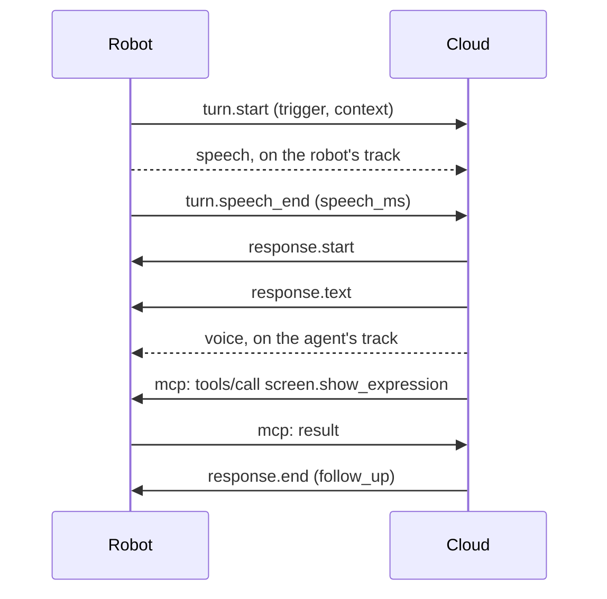

# Cloud link — robot ⇄ ai-robot-server

The link between the robot software and `ai-robot-server`:
- On the robot (`software/`), it is the `cloud` module and the `livekit` adapter of its `cloud` port.
- The server, built anew, does not exist yet.

The robot's core AI runs in the cloud. The robot captures, plays, shows and moves, and keeps everything safe. This link carries:
- speech both ways, and the context of each turn;
- events;
- the calls through which the cloud drives the robot.

Version **2.0**:
- It builds on three ADRs:
  - [ADR-0009](../../docs/decisions/0009-cloud-link-webrtc.md): WebRTC through a LiveKit server;
  - [ADR-0008](../../docs/decisions/0008-cloud-link-messages.md): typed JSON messages, and MCP for capabilities;
  - [ADR-0010](../../docs/decisions/0010-device-identity.md): the robot's identity.
- Version 1.0 carried everything over one WebSocket ([ADR-0007](../../docs/decisions/0007-cloud-link-transport.md), superseded). No server ever spoke it.
- It meets the [requirements](requirements.md), whose identifiers (SES-2, PRIV-1…) it cites.
- [`schema.json`](schema.json) defines every message, in JSON Schema 2020-12.
- [`examples/`](examples/) holds whole sessions. The robot's tests check them, and the robot's own messages, against the schema (`software/tests/test_cloud_protocol.py`, `test_cloud_session.py`).

> **Implemented by the robot so far:**
> - Everything below, but only with tokens it makes itself for a development server ([Joining](#joining)). The token endpoint of ADR-0010 comes with the robot's identity, in a later minor version.
> - The robot offers audio only when a module holds conversations, and its voice module does not yet: it waits for a wake word and voice activity detection.

## The room

The robot and the cloud meet in a LiveKit room, one for each robot. LiveKit carries everything between them:
- the session's messages, as text streams;
- the user's speech and the robot's voice, as audio tracks.

| Participant | Who |
|---|---|
| The robot | Joins with the identity and the room its token names. |
| The cloud | `ai-robot-server`'s agent: a participant of kind `agent`, which only the server's tokens can give. |
| Later: the owner's app | For remote control and the camera, with permissions of its own. |

- **The robot listens only to agents.** It takes messages and audio only from participants of kind `agent`; it ignores, and logs, the rest (SEC-7).
- **Only agents may subscribe to the robot's microphone.** The robot grants the subscription to the agent it holds a session with, and to no one else (PRIV-1).
- **One session at a time.** The robot holds a session with one agent. If another agent joins, the robot keeps the session it has.

## Joining

The robot needs the server's address, `url`, and a token: a JWT that names the room and the robot's identity, and lets it publish its microphone and send data.
- **Address.** `wss://`: TLS, with the server's certificate checked against the system's trusted authorities. `ws://` is accepted only to the robot itself (`127.0.0.1`, `::1`, `localhost`), for development (SEC-1).
- **Tokens from the server.** `ai-robot-server` gives the robot short-lived tokens in exchange for assertions signed by its key ([ADR-0010](../../docs/decisions/0010-device-identity.md)). The token endpoint is specified with the robot's identity, in a later minor version.
- **Tokens for development.** Against a development server, the robot makes its own token with that server's API key and secret, from the environment variables `AI_ROBOT_LIVEKIT_API_KEY` and `AI_ROBOT_LIVEKIT_API_SECRET`. The room and the identity are settings. A robot in a home never holds these.
- **Staying connected.**
  - LiveKit keeps the connection alive and resumes it after a short loss (SES-3, SES-5).
  - When it cannot, the robot joins again after a random wait, from 0 to `min(reconnect_max, reconnect_first × 2ⁿ)`, where n counts the failed attempts in a row. That is 1 s at first, then 2 s, and so on up to 60 s, as shipped: exponential backoff with full jitter (SES-4).
  - A join that reaches the `hello` exchange resets n. Each join opens a new session.
- **The robot's settings.** The robot's timings and rates in this document are settings, in `[ports.cloud.livekit]` of `software/config/base.toml`, and the values given here are those shipped. The sizes, the names and the versions are the protocol's own.

## Messages

- **Text streams.** Each message is one text stream on the topic `ai-robot`, sent to the other side's identity only. It holds one JSON object (UTF-8) with:
  - a `type`;
  - an `id`: a string of up to 64 characters, unique among the messages its sender sends during the session;
  - `reply_to`, in a message that answers another: the `id` it answers.
- **Sizes.** A message holds up to 1 MiB. LiveKit cuts it into chunks on the way. The robot stops reading a larger one and answers `invalid_message`.
- **Order.** Messages from one side arrive in the order sent, and each side handles them in that order.
- **Values.** Numbers are finite: JSON has no NaN. Times are Unix seconds on the sender's clock.
- **Validation.** Each side validates what it receives against [`schema.json`](schema.json) (SEC-14). A message that fails is answered with an `error`, and otherwise ignored. The session goes on (REL-4).
- **Unknown content.** A side ignores message types and fields it does not know, so that a newer minor version can add them (REL-5).
- **Rates.** The robot handles up to `rate` messages a second from the cloud, in bursts of up to `burst`: 50 and 100 as shipped.
  - Messages beyond that wait their turn, up to `backlog` of them, 500 as shipped, so a busy answer loses nothing.
  - Past the backlog, the robot drops what comes in, says so with a `rate_limited` error, and logs it (SEC-15).
- **Resent messages.** A message whose `id` was already handled is ignored, so that a resend never acts twice (SES-6).

| Type | From | Purpose |
|---|---|---|
| `hello` | both | Opens the session: versions, conversations, events |
| `mcp` | both | One MCP message: the cloud calls the robot's capabilities |
| `event` | robot | Something happened that the cloud subscribed to |
| `turn.start` | robot | Someone speaks to the robot: a turn begins |
| `turn.speech_end` | both | The user has finished speaking |
| `turn.cancel` | both | The turn is abandoned |
| `response.start` | cloud | An answer begins; its voice follows on the agent's track |
| `response.text` | cloud | The text of the answer, piece by piece |
| `response.end` | cloud | The answer is complete |
| `response.stop` | cloud | Stop playing the answer, now |
| `response.interrupted` | robot | The user spoke over the answer |
| `error` | both | A message could not be handled |
| `bye` | both | The session ends |

## The session

### `hello`

The robot speaks first. Once it has joined and an agent is in the room, it sends its `hello` to that agent:

```json
{"type": "hello", "id": "r1", "protocol": "2.0", "software": "0.1.0",
 "time": 1792130400.25, "utc_offset": 420, "conversations": true,
 "events": [{"name": "screen.touched", "description": "Someone tapped the screen",
             "schema": {"type": "object", "properties": {"x": {"type": "number"}, "y": {"type": "number"}}}}]}
```

| Field | Meaning |
|---|---|
| `protocol` | The highest version the robot speaks, as `major.minor`. |
| `software` | The robot software's version. |
| `time`, `utc_offset` | The robot's clock, and its offset from UTC in minutes. They give the cloud the robot's local time. |
| `conversations` | Whether the robot holds conversations: it publishes its microphone for turns and plays the agent's voice. |
| `events` | The events the robot can send, each with a JSON Schema of its `data` (EXT-6). Events declared after the `hello` take effect at the next session. |

The agent sends nothing before it, and answers with its own:

```json
{"type": "hello", "id": "c1", "reply_to": "r1", "protocol": "2.0",
 "session": {"id": "s-5f2a"}, "time": 1792130400.31, "conversations": true, "events": ["screen.touched"]}
```

| Field | Meaning |
|---|---|
| `protocol` | The version of the session: the robot's major version, and the lower of the two minor versions. |
| `session.id` | The session, so that logs on both sides can be matched (OPS-3). |
| `time` | The server's clock (IO-14). |
| `conversations` | Whether the agent takes turns and answers with its voice. The session has conversations only if both sides say so. |
| `events` | The events the agent subscribes to. The robot sends only those, and only declared ones. |

- **No answer.** An agent that does not answer within `hello_timeout`, 5 s as shipped, gets a `bye` with the reason `no hello` (SES-2). The robot then ignores it until it leaves and joins again.
- **Another major version.** If the agent speaks another major version, the robot sends `bye` with the reason `unsupported protocol`, and the same follows.

### `bye`

Before ending a session on purpose, a side sends `bye` (SES-7):

```json
{"type": "bye", "id": "r9", "reason": "stopping"}
```

- `reason` is `stopping`, `restarting`, `updating`, or another short word.
- The robot leaves the room after it.
- An agent that leaves the room ends the session too, with or without a `bye`.

## Audio

| Track | Published by | Carries |
|---|---|---|
| `speech`, source microphone | The robot, if it holds conversations | The user's speech, during turns only |
| Any audio track | The agent | The robot's voice |

- **The format** is negotiated by WebRTC, through SDP: Opus, which every WebRTC endpoint supports (RFC 7874). This settles NEG-1 to NEG-6 of the requirements without a scheme of our own.
- **Speech never leaves the robot outside a turn (PRIV-1).** The robot feeds its microphone to the track only from `turn.start` to the end of the user's speech, and keeps the track muted the rest of the time.
- **The robot plays the agent's audio as it comes.** The track is live: the agent sends the voice of its answers at the pace it is spoken, and silence between them.

## Capabilities: MCP

The cloud drives the robot through the robot's capabilities (EXT-1…10). These are MCP tools, revision 2026-07-28, with the robot as the MCP server and the cloud as the client. An `mcp` message carries exactly one MCP JSON-RPC message in `payload`:

```json
{"type": "mcp", "id": "c2",
 "payload": {"jsonrpc": "2.0", "id": 1, "method": "tools/list",
             "params": {"_meta": {"io.modelcontextprotocol/protocolVersion": "2026-07-28",
                                  "io.modelcontextprotocol/clientCapabilities": {}}}}}
```

The robot implements:

| Method | What it does |
|---|---|
| `server/discover` | Returns the supported MCP versions (`2026-07-28`), the server capabilities (`tools.listChanged`), and `serverInfo` in `_meta` |
| `tools/list` | Returns the catalogue in one page, sorted by name |
| `tools/call` | Runs a capability |
| `subscriptions/listen` | With `toolsListChanged`, acknowledges, then sends `notifications/tools/list_changed` whenever the catalogue changes (EXT-4) |
| `notifications/cancelled` | Cancels a call in progress, or ends a subscription |

- **Request metadata.** Every request carries `io.modelcontextprotocol/protocolVersion` and `io.modelcontextprotocol/clientCapabilities` in `params._meta`, as MCP requires. A request for another MCP version gets `UnsupportedProtocolVersion` (−32022).
- **Errors in the request.** A request whose parameters are malformed gets `InvalidParams` (−32602), and so does a call to a tool that is not in the catalogue.
- **Unknown methods** get `MethodNotFound` (−32601).
- **Results** come back in the `payload` of an `mcp` message that names the request's message in `reply_to`.

Each tool definition carries two keys in `_meta`:

| Key | Meaning |
|---|---|
| `ai-robot/safety` | The capability's safety class: `informational`, `privacy`, `physical` or `system` (SEC-8) |
| `ai-robot/version` | The capability's version, an integer (EXT-7) |

**How the robot enforces this:**
- It enforces the safety classes itself. A class its owner has switched off is left out of the catalogue (SEC-9), and a call outside the catalogue is refused like an unknown tool.
- Arguments that do not match the tool's `inputSchema` give a tool error (`isError: true`) whose text says what is wrong. MCP advises this, so that a language model can correct itself.
- A capability that fails, or does not answer within the robot's time limit, also gives a tool error.
- Results carry `structuredContent` that matches the tool's `outputSchema`, and the same JSON as text.

The robot's capabilities today:

| Tool | Class | What it does |
|---|---|---|
| `screen.show_expression` | informational | Shows an expression on the face for a few seconds, as a reaction |
| `screen.set_mood` | informational | Sets a lasting mood, shown when nothing more important is on the face, or clears it |
| `screen.show_scene` | informational | Shows a scene (clock, timer, weather…) with its data while the face watches from a corner, or removes it |

Their schemas come from the screen protocol's [vocabulary](../screen/vocabulary.json), and `tools/list` gives them in full. A new capability needs no change here: its owning module offers it, and the catalogue grows.

## Events

The robot sends an event only if the cloud subscribed to it in its `hello`.

```json
{"type": "event", "id": "r7", "name": "screen.touched", "time": 1792130412.8, "data": {"x": 0.42, "y": 0.61}}
```

`data` matches the schema the robot declared for the event. The robot's events today:

| Event | Data |
|---|---|
| `screen.touched` | `x`, `y`: where, as fractions of the screen's width and height from its top left corner |

## Turns and responses

Only in a session with conversations (see [`hello`](#hello)).



### Turns

- **Starting.** A turn starts when someone speaks to the robot: the wake word, a tap, a button, a follow-up the cloud asked for, or a barge-in. The robot shows that it listens at once, without waiting for the cloud (PERF-1).
  ```json
  {"type": "turn.start", "id": "r4", "turn": "t1", "trigger": "wake_word",
   "context": {"battery": 82.0, "charging": false}}
  ```
  - `turn` is the robot's identifier for the turn.
  - `trigger` is `wake_word`, `tap`, `button`, `follow_up` or `barge_in`.
  - `context` is a snapshot of the robot's situation (IO-4): `battery` (percent) and `charging`, each `null` when unknown. Later minor versions may add fields.
- **Speech.** The robot feeds the user's speech to its `speech` track from `turn.start` until the speech ends.
- **The end of speech.** Either side may decide that the user has finished, and says so with `turn.speech_end`. Once either side has sent it, the robot stops feeding the track.
  - **The robot** decides with voice activity detection, or after 30 s of speech. Its `turn.speech_end` says how much speech it sent, so that the cloud knows when it has all of it: the message and the audio travel apart.
    ```json
    {"type": "turn.speech_end", "id": "r5", "turn": "t1", "speech_ms": 2140}
    ```
  - **The cloud** decides with its own detection, earlier or later, and sends `{"turn": "t1"}`.
- **Cancelling.** Either side may abandon a turn with `turn.cancel` `{"turn": "t1", "reason": "nothing heard"}`.
- **One turn at a time.** A session has at most one turn (SES-8): a new `turn.start` ends the previous turn as if it were cancelled.

### Responses

- **The answer.** The cloud answers with a response. Its voice plays on the agent's track, from about `response.start` to about `response.end`:
  ```json
  {"type": "response.start", "id": "c5", "response": "a1", "turn": "t1"}
  {"type": "response.text", "id": "c6", "response": "a1", "delta": "It is sunny"}
  {"type": "response.end", "id": "c9", "response": "a1", "follow_up": false}
  ```
  - `turn` is `null` for an answer that no turn asked for, such as a reminder.
  - `response.text` gives the text of the speech in pieces, `delta`, for the screen and the logs.
  - `follow_up: true` asks the robot to listen again once it has played the answer. It does so with a turn whose trigger is `follow_up`.
  - The cloud may call capabilities during an answer, such as an expression while it speaks.
- **One response at a time.** A `response.start` that comes before the previous response's `response.end` ends that response, as `response.end` would.
- **Stopping.** `response.stop` `{"response": "a1"}` asks the robot to stop playing at once, and to drop what it still holds. The agent stops its voice too.
- **Barge-in.** When the user speaks over an answer, the robot stops playing at once, on its own (PERF-3), and sends `response.interrupted` `{"response": "a1"}`.
  - The agent stops its voice and forgets what was not played. It knows what it sent, and when.
  - A new turn follows, with the trigger `barge_in`.

## Errors

```json
{"type": "error", "id": "r8", "reply_to": "c7", "code": "invalid_message",
 "message": "session: 'id' is a required property"}
```

| Code | Meaning |
|---|---|
| `invalid_message` | The message failed `schema.json`, or was too large |
| `unknown_turn`, `unknown_response` | The message names a turn or a response the receiver does not know |
| `rate_limited` | The sender sent too many messages; some were dropped |
| `internal` | The receiver failed to handle a valid message |

A message about a turn or a response that has ended is ignored, not refused: it may have crossed the end on its way.

## Changing the protocol

- **No version change.** A new capability or event needs no protocol change: the robot's catalogue and `hello` carry them.
- **Minor version.** A new message type, or a new optional field, raises the minor version. Update this file, `schema.json` and the examples, then the robot, in the same pull request.
- **Major version.** Changing or removing anything a side relies on raises the major version, and the server supports the previous major version for a while (REL-5).
- **Where the version lives.** It appears here, in `schema.json` (`title`), and as `PROTOCOL` in `software/src/ai_robot/adapters/livekit/session.py`.
- **MCP.** The MCP revision is pinned and changes deliberately (ADR-0008). `server/discover` lets the robot support two revisions during a change.
